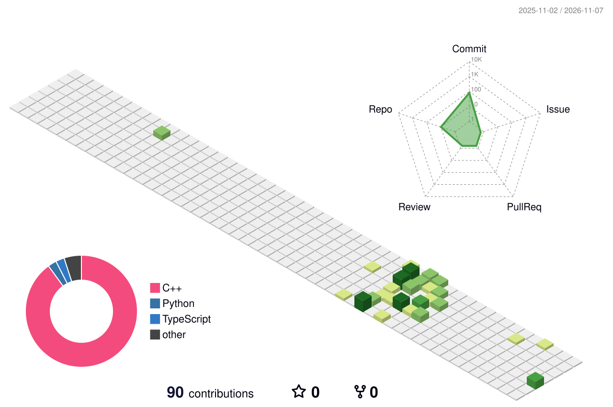

<p align="center">
  
</p>

<p align="center">
  
  
</p>

---

### `> whoami`

```ts
const yash = {
  role: ["Compiler tinkerer", "ML builder", "Full-stack dev"],
  studying: "B.Tech CS @ NMIMS MPSTME Shirpur",
  leads: "PR & Documentation @ NMIMS Coding Club",
  member: "AIML Team @ GDGoC on Campus",
  currentlyBuilding: "things that make tutorials obsolete",
  because: "the repos speak for themselves",
};
```

---

### Selected work

| | Project | The flex |
|---|---|---|
| 🖥️ | [**BhiduLang**](https://github.com/b-yash2909/BhiduLang-v1) | A programming language with a real compiler: lexer → parser → AST → IR → optimizer → JS. TypeScript. |
| 🍽️ | [**NMIMS-Eats**](https://github.com/b-yash2909/NMIMS-Eats) | Full-stack campus platform. FastAPI, PostgreSQL, JWT auth. |
| 🧠 | [**EEG Quantum Neural Net**](https://github.com/b-yash2909/EEG-Quantum_Neural_Network) | Quantum-classical hybrid that reads brain states. PennyLane + PyTorch. |

---

### Arsenal

<p align="center">
  
</p>

---

### Activity

<p align="center">
  
</p>

<p align="center">
  
  
</p>

---

<p align="center">
  <a href="mailto:yashbhardwaj290906@gmail.com"></a>
  <a href="https://www.linkedin.com/in/yash-bhardwaj-5b9040320/"></a>
</p>

<p align="center"><sub>If you're reading this, you're either hiring or curious. Both are good choices.</sub></p>


